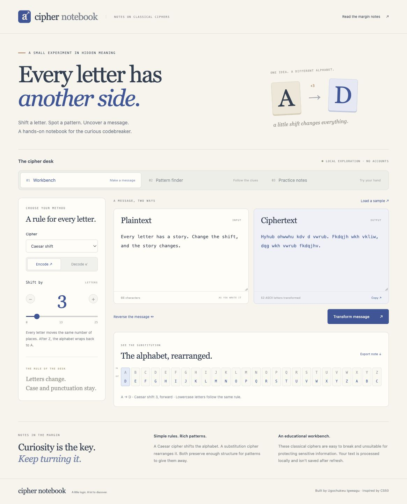

# Cipher Notebook · Cipher Playgrounddd

**Every letter has another side.** A local, interactive notebook for Caesar shifts, substitution alphabets, frequency analysis, and original decoding puzzles.

The browser and CLI share one Python engine. No packages, build tools, accounts, or external APIs are required. These classical ciphers are educational and unsuitable for protecting sensitive information.



## Run locally

Requires **Python 3.9+**.

```sh
git clone https://github.com/Ugo175/cipher-playground.git
cd cipher-playground
python3 server.py
```

Open **http://127.0.0.1:8773**. Stop with `Ctrl+C`. If that port is occupied, use `python3 server.py --port 8774` and open the printed URL.

## A one-minute demo

1. The Workbench starts with a three-letter Caesar shift: **A → D**. Select a letter in the alphabet strip to trace its mapping.
2. Choose **Reverse the message**. The output becomes the input, the direction flips, and decoding restores the original sentence.
3. Select **Substitution alphabet**, then **Try a reversed alphabet**. `Hello, World! 😀` encodes as `Svool, Dliow! 😀`.
4. Open **Pattern finder**. The included example has 35 ASCII letters. Shift 3 decodes it to `The quick brown fox jumps over the lazy dog.` Show all 26 candidates and inspect a frequency bar.
5. Choose **Use this shift** on a candidate to transfer its settings into the Workbench.
6. Open **Practice notes**. Try the three original Caesar puzzles, ask for hints, check a plaintext answer, or explicitly reveal a solution.

See the [walkthrough and verification checklist](docs/DEMO.md), [analysis screenshot](docs/analysis.jpg), and [mobile screenshot](docs/mobile.jpg).

## Workbench

### Caesar shift

Each ASCII letter moves by the same number of positions and wraps after Z. Browser controls cover shifts 0–25; the CLI supports any integer, wrapping modulo 26. The browser API accepts integer shifts up to ±1,000,000.

Encoding uses the forward shift; decoding uses its inverse. The alphabet strip shows the mapping for the **current direction**, so decoding with shift 3 maps A to X, not D. Case, punctuation, spaces, numbers, emoji, and non-ASCII characters are preserved.

### Substitution alphabet

Supply exactly 26 unique ASCII letters, ignoring case. The first replaces A, the second replaces B, and so on. Decoding inverts the key. Invalid, repeated, missing, and non-ASCII key characters are rejected.

### Reports and stale results

Transforming is explicit. Changing text, direction, or key marks the existing output stale and disables copy, reverse, export, and letter selection until another transformation succeeds.

Copy writes the current output to the clipboard when browser permissions allow it; the output remains selectable if clipboard access is unavailable. Export downloads JSON with the input, output, method, direction, normalized shift or key, letter mapping, counts, and both input/output frequency tables. Exported notes **include the original text**.

## Pattern finder

The frequency chart counts **ASCII A–Z only**, ignoring case. Non-ASCII characters are preserved in text but excluded from counts, including characters such as K, İ, and ſ that can otherwise turn into ASCII letters during Unicode case conversion.

Bars are scaled to the highest percentage in the current message; select a bar for its exact count and percentage. Percentages use only recognized ASCII letters as their denominator. Empty and punctuation-only messages yield zero counts and no decoding candidates.

Caesar decoding tries all **26** encryption shifts and ranks the results by chi-squared distance from a fixed conventional English letter-frequency table. Lower scores are closer statistical matches. Short, unusual, or non-English text can rank the correct answer poorly; the tool shows all candidates and never claims that the highest-ranked guess is certainly correct.

`encryption_shift` in reports is the original forward shift. The inverse is applied to decode each candidate. Pattern finder does not attempt to automatically solve arbitrary substitution ciphers.

## Practice notes

Three original messages are encoded using different Caesar shifts. Hints help you find an entry point, and **Open in workbench** copies a challenge into decode mode with shift zero so you can explore it.

Answer checks ignore case and repeated/leading/trailing whitespace, but retain punctuation. Wrong answers do not return the plaintext. A correct answer or explicit reveal shows the original message and shift. Reveals are labeled as reveals; there is no fabricated score, persistent completion record, or competitive ranking.

These are learning puzzles, not a secret-storage system. Their source and solutions are included in this public repository.

## Command-line interface

```sh
python3 cipher.py caesar --text 'Hello, world!' --shift 7
python3 cipher.py caesar --text 'Olssv, dvysk!' --shift 7 --decrypt
python3 cipher.py substitution --text 'Hello!' --key QWERTYUIOPASDFGHJKLZXCVBNM
python3 cipher.py frequency --file examples/message.txt
python3 cipher.py crack --text 'Wkh txlfn eurzq ira mxpsv ryhu wkh odcb grj'
```

The CLI and browser use the same transformations, frequency counts, and candidate ranking. CLI `crack` rejects input with no ASCII letters; the browser displays a graceful empty-analysis result.

## Architecture and lifecycle

```text
web/ → local HTTP API → server.py → notebook.py → cipher.py
                                                     ↑
                                               command-line tool
```

`cipher.py` contains the algorithms. `notebook.py` adds validation, mappings, statistics, and challenge reports. `server.py` uses the Python standard library. The browser renders those reports with plain HTML, CSS, and JavaScript; it does not maintain a second cipher implementation.

The app binds to loopback, serves a fixed asset list, rejects foreign hosts/origins, and supplies a content security policy. Dynamic message content is inserted using text nodes and textarea values. Requests are limited to 2 MiB, and browser/API messages to 20,000 Unicode characters. Browser textareas may impose a stricter limit on characters represented by surrogate pairs. The CLI has no corresponding text-length cap.

No messages, keys, or puzzle progress are saved to a database, server file, or browser storage. Refresh resets the notebook; downloaded notes remain wherever the browser saves them. The local development server is for trusted personal use, not public production hosting.

Keyboard-accessible tabs, labeled controls, focus indicators, live announcements, responsive layouts, and reduced-motion support are included. Alphabet and chart strips scroll within their panels on small screens.

## Verification

```sh
python3 -m unittest discover -s tests -v
```

The **14 tests** cover known vectors, long-text round trips, Unicode preservation, exact mappings, key validation, ASCII-only counts, negative shifts, wrapping, all 26 candidates, puzzle checks, browser/CLI parity, HTTP validation, and local-server access controls. HTTP tests briefly bind a loopback server.

Browser checks cover encode/decode reversal, substitution, invalid keys, stale output, copying, JSON export, frequency bars, candidate transfer, hints, wrong/correct answers, reveals, empty analysis, and mobile layouts. See [docs/DEMO.md](docs/DEMO.md).

## Future work

Custom frequency tables, more original challenge sets, optional substitution-solving hints, and additional historical ciphers with clear educational limits.

## Origins

Created by **Ugochukwu Igweagu**, inspired by the Caesar and Substitution exercises in [my CS50 projects collection](https://github.com/Ugo175/projects). This standalone implementation adds a browser notebook, explicit alphabet mappings, frequency exploration, ranked decoding candidates, puzzles, exports, and HTTP integration tests. See [ATTRIBUTION.md](ATTRIBUTION.md).
