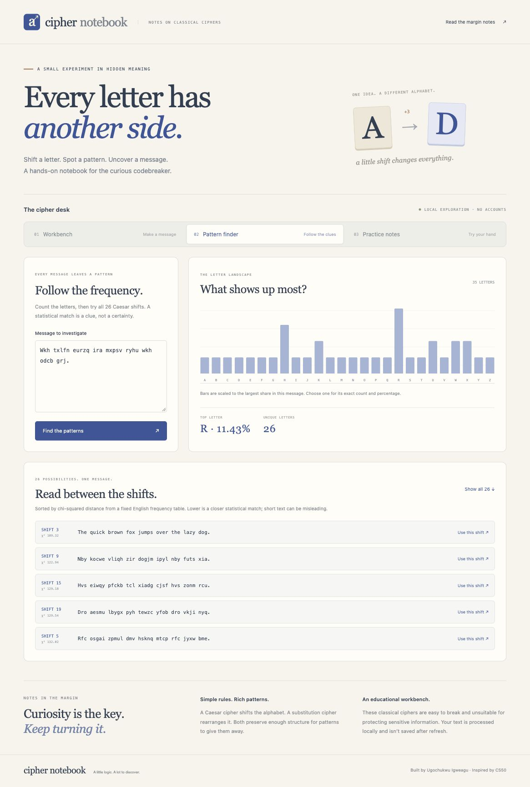

# Cipher Notebook walkthrough

Run `python3 server.py` and open the printed local URL. The three views share one Python cipher engine and require no external account or package installation.

## 1. Make a message

The initial Caesar shift is three: A maps to D, and Z wraps to C. The source sentence is encoded while preserving spaces, punctuation, and case. Select any letter to trace its mapping.

Choose Reverse the message. The encoded output becomes the new input, the direction changes to decode, and the original message returns. The alphabet display now shows inverse mappings such as A → X.


## 2. Follow a pattern

Pattern finder starts with a Caesar-encoded pangram. It contains 35 ASCII letters. Shift 3 restores:

> The quick brown fox jumps over the lazy dog.

Select a frequency bar to see its count and share; for example, E appears once in the ciphertext and accounts for 2.86% of its ASCII letters. Show all 26 candidates to inspect every possible Caesar shift. Use this shift transfers a candidate into the Workbench.



Ranking is statistical. This example’s correct shift ranks first, but other short messages may not. The app exposes all candidates rather than treating the top guess as certain.

## 3. Open a practice note

Practice notes contains three original messages. The first hint explains that M became P. Try a wrong answer to see corrective feedback, then solve the note by decoding it. Case and extra whitespace are ignored, while punctuation must match. An explicit reveal displays the message and shift and is labeled as a reveal.

## Browser verification checklist

- Default Caesar encoding and Reverse the message restore the source sentence exactly.
- Decoding with shift three shows A → X in the letter mapping.
- A reversed substitution alphabet transforms `Hello, World! 😀` into `Svool, Dliow! 😀`.
- A repeated-letter substitution key shows a useful validation error.
- Edits mark output stale and disable export, copy, reverse, and letter selection until a successful transform.
- Copy completes successfully; export contains the sample input, output, shift three, and 26 mapping entries.
- Pattern finder renders 26 frequency bars and can show all 26 decoding candidates.
- A selected frequency bar displays its precise count and percentage.
- Use this shift transfers the correct candidate and direction into the Workbench.
- Puzzle hints, wrong answers, correct answers, and explicit reveals produce the appropriate feedback.
- An analysis message containing only punctuation and emoji produces no candidates gracefully.
- Workbench and analysis fit a narrow mobile viewport without horizontal document overflow; long alphabet/chart strips scroll inside their panels.
- The verified flows produce no JavaScript errors.

## Mobile

[Open the full mobile screenshot](mobile.jpg).

## Automated checks

```sh
python3 -m unittest discover -s tests -v
```

The suite checks algorithms and exact CLI/API agreement, including Unicode cases that must not be included in ASCII frequency counts. Screenshots use original sample text and demonstrate actual app behavior.
